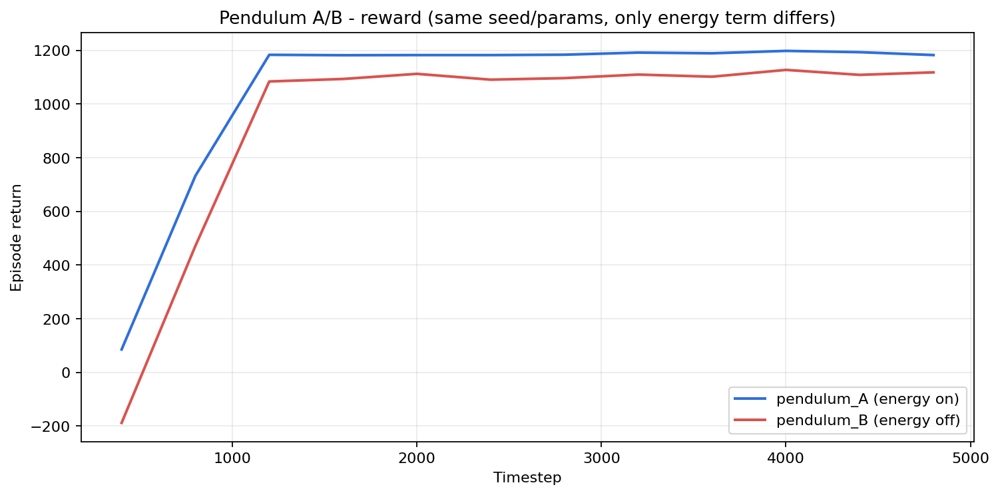

# 第 4 周训练曲线数值摘要

## acrobot_demo

- event 文件：`/home/ubuntu/motrixlab-cartpole-ppo/motrixlab/runs/week4/acrobot_demo/events.out.tfevents.1794745597.cdl8js5vb8-767c7cf587-psjqq.21350.0`
- scalar 标签数：14

| 指标 | 首值 | 末值 | 末段均值(10%) | 最大 | 记录点数 |
| --- | --- | --- | --- | --- | --- |
| `Reward / Total reward (mean)` | 5.90347 | 236.253 | 209.284 | 236.253 | 58 |
| `Reward / Total reward (min)` | -18.8085 | 95.0901 | 81.7752 | 129.87 | 58 |
| `Reward / Total reward (max)` | 75.2413 | 335.295 | 329.382 | 367.744 | 58 |
| `Loss / Value loss` | 0.431367 | 0.0145582 | 0.0195031 | 0.431367 | 100 |
| `Loss / Policy loss` | 0.00130756 | 0.000405572 | 0.00150441 | 0.0132607 | 100 |

## pendulum_A

- event 文件：`/home/ubuntu/motrixlab-cartpole-ppo/motrixlab/runs/week4/pendulum_A/events.out.tfevents.1794744003.cdl8js5vb8-767c7cf587-psjqq.14123.0`
- scalar 标签数：13

| 指标 | 首值 | 末值 | 末段均值(10%) | 最大 | 记录点数 |
| --- | --- | --- | --- | --- | --- |
| `Reward / Total reward (mean)` | 85.3364 | 1182.41 | 1182.41 | 1197.92 | 12 |
| `Reward / Total reward (min)` | -440.451 | 1050.59 | 1050.59 | 1087.53 | 12 |
| `Reward / Total reward (max)` | 325.733 | 1239.49 | 1239.49 | 1239.49 | 12 |
| `Loss / Value loss` | 4.5899 | 1.85305e-05 | 0.000851913 | 4.5899 | 100 |
| `Loss / Policy loss` | -0.00358219 | 0.00057275 | -0.0036512 | 0.0249894 | 100 |

## pendulum_B

- event 文件：`/home/ubuntu/motrixlab-cartpole-ppo/motrixlab/runs/week4/pendulum_B/events.out.tfevents.1794744116.cdl8js5vb8-767c7cf587-psjqq.15220.0`
- scalar 标签数：13

| 指标 | 首值 | 末值 | 末段均值(10%) | 最大 | 记录点数 |
| --- | --- | --- | --- | --- | --- |
| `Reward / Total reward (mean)` | -188.264 | 1117.97 | 1117.97 | 1127.11 | 12 |
| `Reward / Total reward (min)` | -671.848 | 955.516 | 955.516 | 955.516 | 12 |
| `Reward / Total reward (max)` | -19.6929 | 1198.86 | 1198.86 | 1198.86 | 12 |
| `Loss / Value loss` | 4.51648 | 1.42284e-05 | 0.000460874 | 4.51648 | 100 |
| `Loss / Policy loss` | -0.00380551 | -0.00699257 | -0.0059007 | 0.0188907 | 100 |

## pendulum_demo

- event 文件：`/home/ubuntu/motrixlab-cartpole-ppo/motrixlab/runs/week4/pendulum_demo/events.out.tfevents.1794742036.cdl8js5vb8-767c7cf587-psjqq.5427.0`
- scalar 标签数：13

| 指标 | 首值 | 末值 | 末段均值(10%) | 最大 | 记录点数 |
| --- | --- | --- | --- | --- | --- |
| `Reward / Total reward (mean)` | 85.3364 | 1182.41 | 1182.41 | 1197.92 | 12 |
| `Reward / Total reward (min)` | -440.451 | 1050.59 | 1050.59 | 1087.53 | 12 |
| `Reward / Total reward (max)` | 325.733 | 1239.49 | 1239.49 | 1239.49 | 12 |
| `Loss / Value loss` | 4.5899 | 1.85305e-05 | 0.000851913 | 4.5899 | 100 |
| `Loss / Policy loss` | -0.00358219 | 0.00057275 | -0.0036512 | 0.0249894 | 100 |

## Pendulum A/B 对照（同一 seed=42、同一套超参，只差能量项）

| 组 | 末段均值(10%) | 末值 | 最大 |
| --- | --- | --- | --- |
| A（能量项保留） | 1182.4078 | 1182.4078 | 1197.9218 |
| B（能量项系数 0） | 1117.9700 | 1117.9700 | 1127.1112 |
| 差值 A-B | +64.4379 | +64.4379 | |

> 注：末段均值反映“收敛后能拿多少分”，首值反映“刚起步多难”。
> 单摆理论上限为 3.10/步 × 400 步 = 1240。

